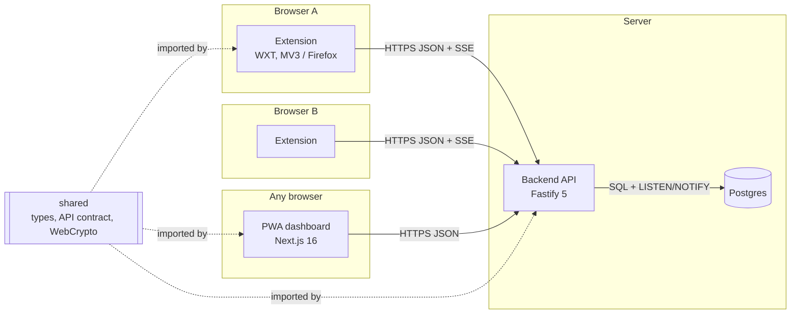
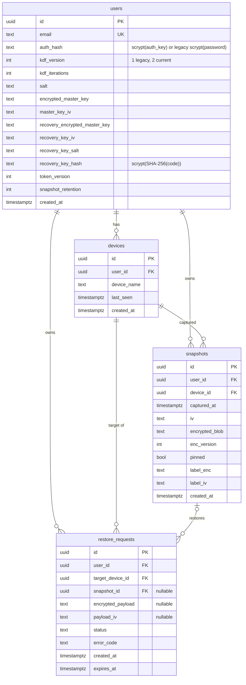

# Architecture

VaultTabs is an npm-workspaces monorepo with four packages. All encryption and decryption happens in the
clients; the server stores ciphertext and routes messages between a user's devices.



## Components

### `shared/` (`@vaulttabs/shared`)

- `crypto.ts`: the only implementation of client-side crypto (key derivation, master-key wrapping,
  recovery codes, snapshot / send-tab / label encryption, URL safety checks). Pure WebCrypto, so it runs in
  browsers, extension service workers and Node (for tests).
- `api.ts`: the HTTP contract (payloads, responses, `LIMITS`). See [api.md](api.md).
- `models.ts`: domain models and restore error codes.

It is compiled to `shared/dist` and consumed by the other workspaces; build it first.

### `backend/`

Fastify 5 API with zod validation and the `postgres` driver.

- Layers: routes (HTTP + validation) → services (business rules) → repositories (SQL).
- Auth: scrypt-hashed `auth_key`, HS256 JWTs with a per-user `token_version` checked on every request.
- Real-time: `GET /restore/stream` (Server-Sent Events). When a restore request is created, the backend
  issues `NOTIFY`; every backend instance `LISTEN`s and pushes the event to the target device's open
  streams.
- Operations: versioned SQL migrations (`schema_migrations`), `/health` and `/ready`, graceful shutdown,
  pino logging with redaction, an in-process cleanup job (retention pruning, expiring restore requests)
  every `CLEANUP_INTERVAL_MINUTES`, rate limiting, helmet, CORS allow-list.
- Configuration is validated at startup (`backend/src/config.ts`); see
  [self-hosting.md](self-hosting.md#environment-reference).

### `extension/`

A [WXT](https://wxt.dev) extension (Chrome MV3, Firefox).

- Background: watches tab events, debounces, captures `http(s)` tabs of normal windows (never incognito,
  never domains on the never-sync list), skips unchanged lists (SHA-256 of the list), encrypts and uploads.
  Sends heartbeats and keeps an SSE connection to receive "send tab" requests, then opens the URLs.
- Popup: login/registration, status, quick "send this tab / window to device".
- Stores the master key as a non-extractable `CryptoKey` in IndexedDB and the session in
  `chrome.storage.local`.
- Built against one API URL (`VITE_API_URL`), which is its only host permission.

### `pwa/`

A Next.js 16 (React 19) installable web app: devices and their current tabs, search across devices, history
with time travel and diff, saved sessions, send tab/window/snapshot to a device, export (JSON / bookmarks
HTML), account settings (change password, recovery code, sign out everywhere, retention, delete account),
auto-lock. Strict nonce-based CSP. Built as a standalone Node server for Docker.

## Data model

Simplified (see the backend migrations for the authoritative schema):



Column names in the diagram are illustrative where they are server-internal (e.g. the hash columns).

## Flows

### Registration

```mermaid
sequenceDiagram
  autonumber
  actor U as User
  participant C as Client (extension / PWA)
  participant S as Backend
  participant DB as Postgres
  U->>C: email + password
  C->>C: master key = random AES-256-GCM
  C->>C: salt = 32 random bytes; root = PBKDF2(password, salt, 600k)
  C->>C: auth_key, wrapping key = HKDF(root)
  C->>C: wrap master key (wrapping key)
  C->>C: recovery code (100 bit); wrap master key (PBKDF2(code)); verifier = SHA-256(code)
  C->>S: POST /auth/register {email, auth_key, salt, kdf_*, wrapped keys, recovery material}
  S->>DB: insert user (scrypt(auth_key), scrypt(verifier), ciphertexts)
  S-->>C: 201 {token, user, crypto}
  C->>U: show recovery code once
```

### Login (and legacy upgrade)

```mermaid
sequenceDiagram
  autonumber
  participant C as Client
  participant S as Backend
  C->>S: POST /auth/prelogin {email}
  S-->>C: {kdf_version, kdf_iterations, salt} (fake but stable for unknown emails)
  alt kdf_version 2
    C->>C: check iterations in [600k, 10M]; derive auth_key + wrapping key
    C->>S: POST /auth/login {email, auth_key}
    S-->>C: {token, user, crypto: wrapped master key}
    C->>C: unwrap master key locally (non-extractable)
  else kdf_version 1 (legacy)
    C->>S: POST /auth/login {email, password}
    S-->>C: {token, crypto, upgrade_required: true}
    C->>C: unwrap with legacy key; create v2 password material
    C->>S: POST /auth/upgrade {password, v2 material}
    S-->>C: AuthResponse (kdf_version 2)
  end
  C->>S: POST /devices/register {device_name, id?}
  S-->>C: {device}
```

### Sync (extension)

```mermaid
sequenceDiagram
  autonumber
  participant B as Browser tabs
  participant E as Extension background
  participant S as Backend
  participant DB as Postgres
  B->>E: tab created / updated / removed / moved
  E->>E: debounce; collect http(s) tabs; drop never-sync domains
  E->>E: SHA-256(list) unchanged? stop
  E->>E: encrypt JSON with master key, AAD = snapshot/v2|user|device|captured_at
  E->>S: POST /snapshots {device_id, captured_at, iv, encrypted_blob, enc_version: 2}
  S->>DB: insert; prune beyond retention (unpinned only)
  S-->>E: 201 {snapshot_id}
  Note over S,DB: PWA / other devices: GET /snapshots/latest, decrypt with the same AAD
```

### Send tab to a device

```mermaid
sequenceDiagram
  autonumber
  participant P as Sender (PWA / extension)
  participant S as Backend instance 1
  participant DB as Postgres
  participant S2 as Backend instance 2
  participant T as Target extension
  T->>S2: GET /restore/stream?device_id=T (SSE, kept open)
  S2->>DB: LISTEN
  P->>P: encrypt {urls}, AAD = restore/v1|user|T
  P->>S: POST /restore {target_device_id: T, encrypted_payload, payload_iv}
  S->>DB: insert restore_request (pending); NOTIFY
  DB-->>S2: notification
  S2-->>T: data: {pending: true, request}
  T->>T: decrypt with own device id; keep only http(s) URLs
  T->>T: open tabs
  T->>S2: PATCH /restore/:id {status: completed | failed, error_code}
  P->>S: GET /restore/:id (poll status)
```

If the target is offline it picks the request up with `GET /restore/pending` when it reconnects, unless the
request has expired.

### Restore a snapshot

Same as above with `snapshot_id` instead of an encrypted payload: the target receives the snapshot
ciphertext and decrypts it with the snapshot's own AAD (user, source device, `captured_at`). The PWA can
also simply open the decrypted URLs in the current browser without involving another device.

## Security

See [security-model.md](security-model.md) for the threat model, exact parameters and limitations.
